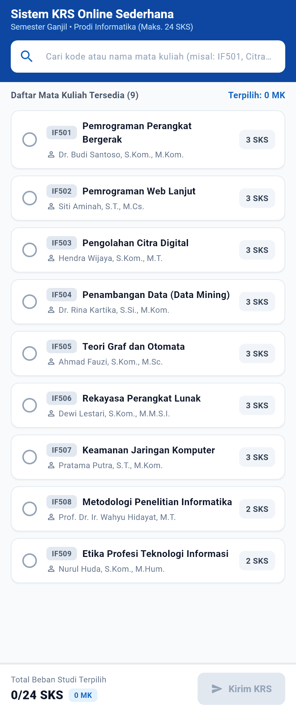
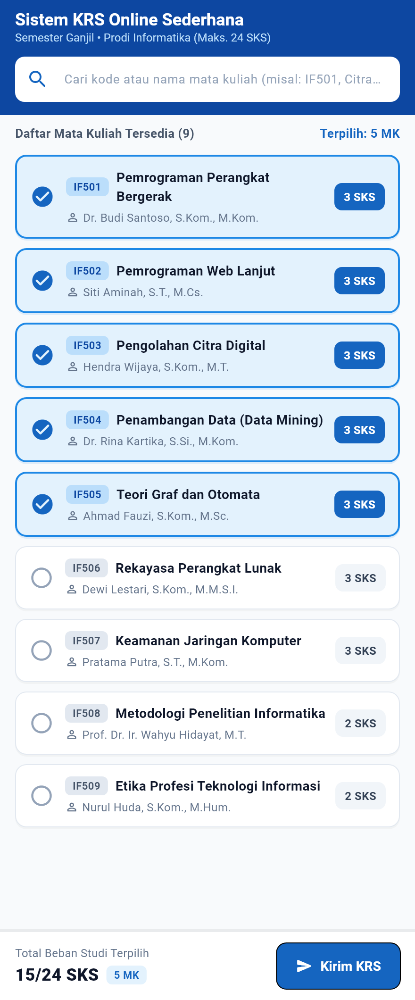
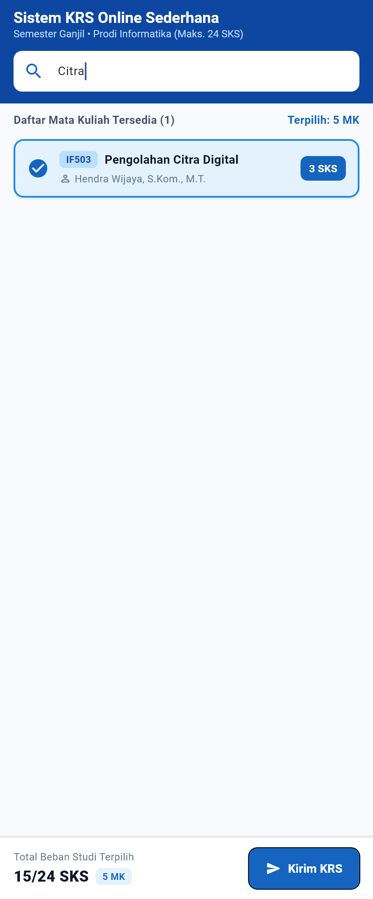
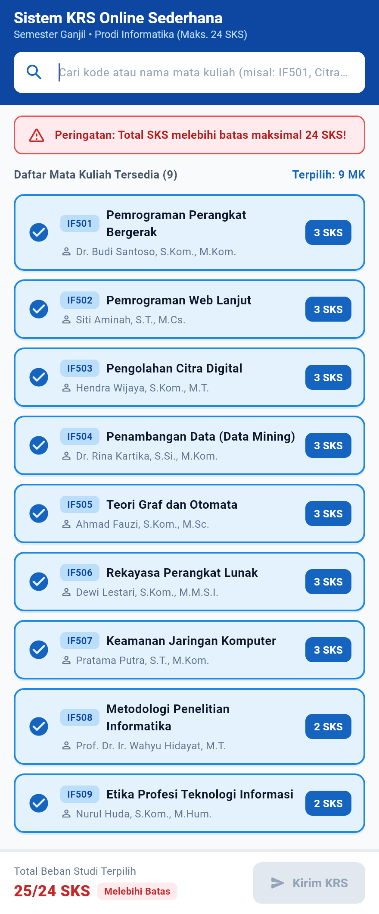
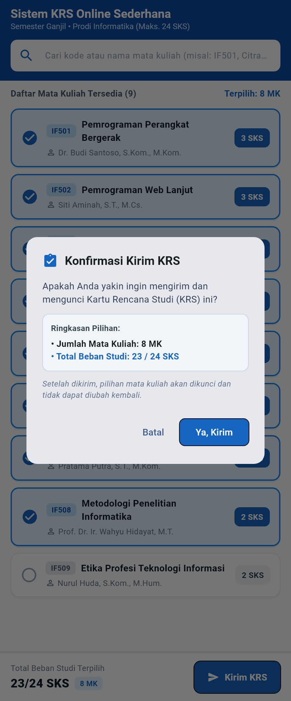
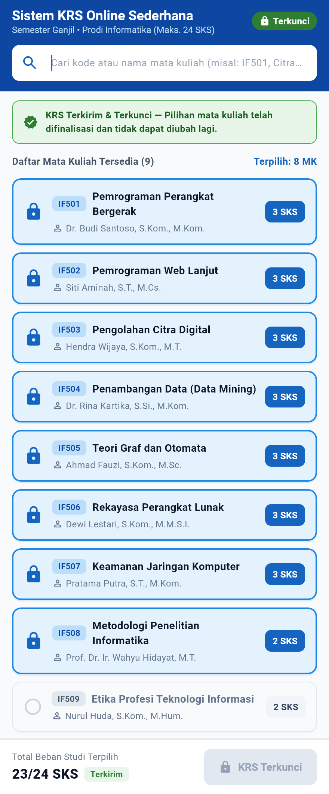

# Sistem KRS Online Sederhana

Proyek aplikasi **Sistem KRS Online Sederhana** berbasis Flutter yang dibuat untuk memenuhi tugas mata kuliah **Mobile Programming** pada materi **Bab 6 (Pengelolaan State dan Interaksi Pengguna)**.

Aplikasi ini mensimulasikan proses pengisian Kartu Rencana Studi (KRS) mahasiswa secara langsung dalam satu layar menggunakan pengelolaan state lokal (`StatefulWidget`, `StatelessWidget`, dan `setState()`).

---

## Identitas Mahasiswa

- **Nama:** Muhammad Lutfi Maulana
- **NIM:** 2495114039
- **Kelas:** TI-5A
- **Mata Kuliah:** Mobile Programming

---

## Fitur Aplikasi

1. **Daftar Mata Kuliah (`ListView.builder`)**
   Menampilkan 9 mata kuliah lengkap dengan kode, nama mata kuliah, jumlah SKS, dan dosen pengampu.
2. **Pencarian Mata Kuliah (`TextField` dengan `onChanged`)**
   Memudahkan pencarian mata kuliah berdasarkan kode maupun nama mata kuliah secara langsung tanpa mereset mata kuliah yang sudah dipilih sebelumnya.
3. **Pemilihan & Pembatalan Mata Kuliah**
   Mahasiswa cukup mengetuk kartu mata kuliah untuk memilih atau membatalkan mata kuliah selama KRS belum dikirim.
4. **Perhitungan & Validasi Batas Maksimal 24 SKS**
   Total SKS dihitung otomatis setiap kali pilihan berubah. Jika total SKS melebihi 24 SKS, aplikasi menampilkan pesan peringatan dan menonaktifkan tombol pengiriman KRS.
5. **Konfirmasi & Penguncian KRS (`AlertDialog`)**
   Sebelum KRS dikirim, muncul dialog konfirmasi berisi ringkasan jumlah mata kuliah dan SKS. Setelah disetujui, status KRS terkunci dan tidak dapat diubah lagi.
6. **Animasi Kartu Mata Kuliah (`AnimatedContainer`)**
   Perubahan warna latar dan garis tepi kartu berlangsung halus (250 ms) saat mata kuliah dipilih atau dibatalkan.

---

## Penerapan Konsep Bab 6

- **`StatefulWidget` (`KrsPage`)**: Mengelola state utama halaman, yaitu daftar kode mata kuliah yang dipilih (`selectedCourseCodes`), kata kunci pencarian (`searchQuery`), serta status pengiriman KRS (`isSubmitted`).
- **`StatelessWidget` (`CourseCard`)**: Menampilkan komponen kartu mata kuliah dan meneruskan aksi ketukan ke halaman utama melalui *callback* (`VoidCallback`).
- **Perhitungan di `build()`**: Daftar hasil pencarian (`filteredCourses`), akumulasi SKS (`totalSks`), dan pengecekan batas SKS (`isOverLimit`) dihitung langsung di dalam `build()` agar selalu sinkron dengan state yang aktif.

---

## Tampilan Aplikasi

| Skenario | Keterangan | Tangkapan Layar |
| :--- | :--- | :---: |
| **1. Tampilan Awal** | Daftar 9 mata kuliah tampil, pencarian masih kosong, total SKS `0/24 SKS`, dan tombol Kirim KRS belum aktif. |  |
| **2. Memilih Mata Kuliah** | Memilih 5 mata kuliah (`15/24 SKS`). Kartu yang dipilih berubah warna menjadi biru muda dan tombol Kirim KRS aktif. |  |
| **3. Pencarian Mata Kuliah** | Mencari mata kuliah dengan kata kunci `"Citra"`. Daftar tersaring secara langsung dan pilihan SKS sebelumnya tetap tersimpan. |  |
| **4. Melebihi Batas 24 SKS** | Saat semua mata kuliah dipilih (`25/24 SKS`), muncul peringatan batas maksimal 24 SKS dan tombol Kirim KRS dinonaktifkan. |  |
| **5. Konfirmasi Kirim KRS** | Dialog konfirmasi muncul saat menekan tombol Kirim KRS untuk memastikan pilihan sebelum dikunci. |  |
| **6. KRS Terkirim & Terkunci** | Setelah dikonfirmasi, muncul keterangan bahwa KRS telah terkunci sehingga kartu mata kuliah dan tombol tidak bisa ditekan lagi. |  |

---

## Struktur Folder

```text
lib/
├── main.dart              # Entry point aplikasi
├── models/
│   └── course.dart        # Model Course & data mata kuliah
├── screens/
│   └── krs_page.dart      # Halaman utama KRS (StatefulWidget)
└── widgets/
    └── course_card.dart   # Widget kartu mata kuliah (StatelessWidget)
```

---

## Cara Menjalankan Aplikasi

1. **Melalui Google Chrome (Web):**
   ```bash
   flutter run -d chrome
   ```

2. **Melalui Perangkat Android:**
   Pastikan *USB Debugging* aktif dan perangkat terhubung, lalu jalankan:
   ```bash
   flutter devices
   flutter run -d <device_id>
   ```
